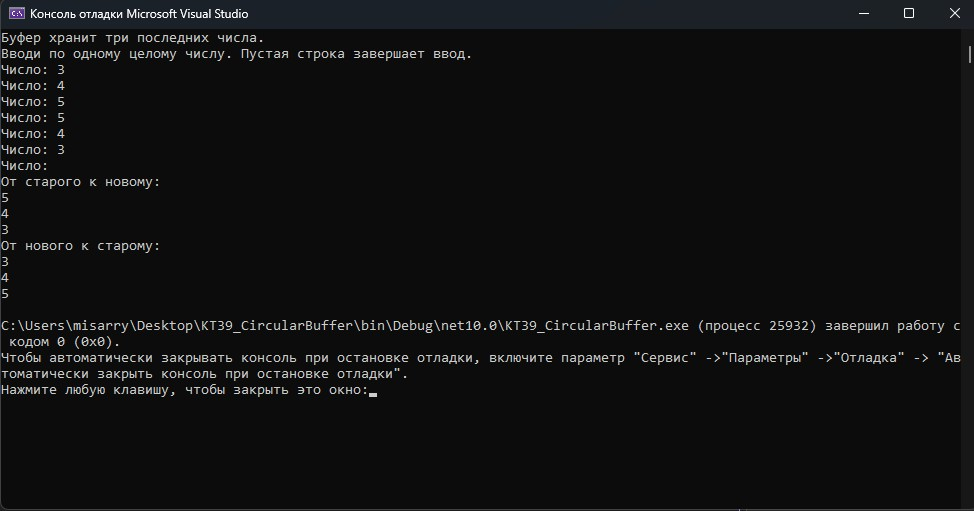

# КТ №39. Пользовательские итераторы

Вариант 1. Кольцевой буфер.

Буфер хранит последние три числа. Если он уже заполнен, новое число заменяет самое старое.

Для проверки можно ввести 1, 2, 3, 4, 5. Обычный `foreach` выведет 3, 4, 5, а `foreach` с методом `Reverse()` выведет 5, 4, 3. Оба обхода отдают числа по одному через `yield return`.

## Скриншоты

